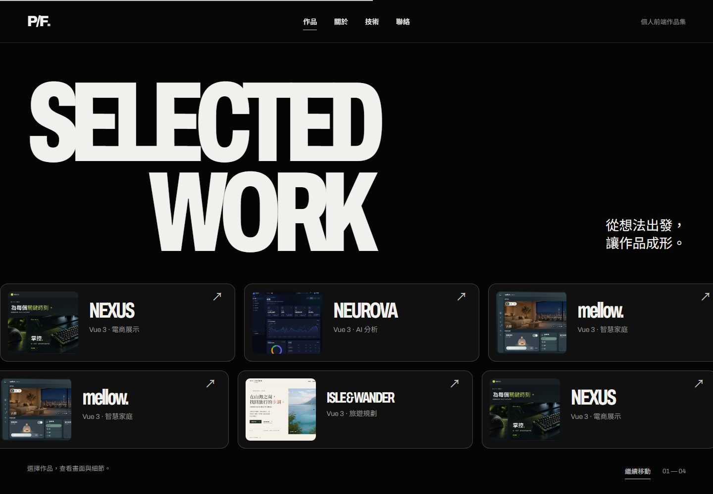
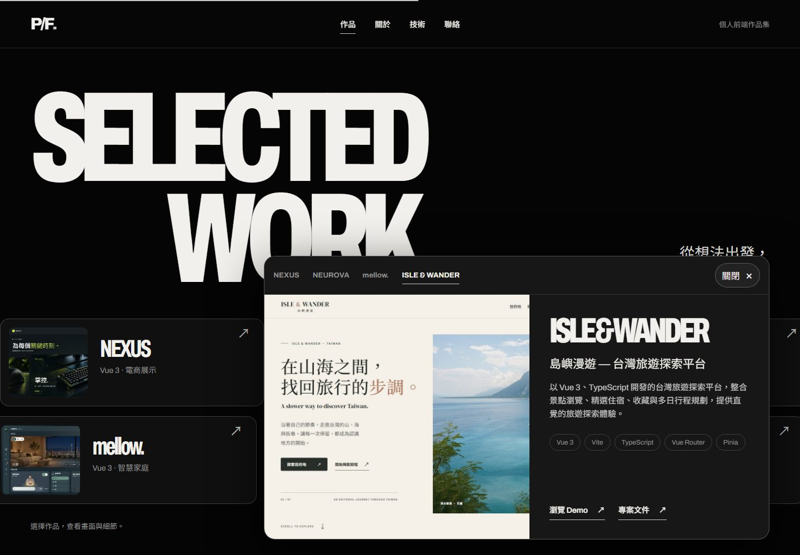

# Personal Portfolio

**Creative Frontend Developer Portfolio** — a single-page site presenting frontend development, interaction design, responsive interfaces, WebGL work, and four completed project demos.

## Features

- A custom WebGL2 chrome sculpture with pointer response, scroll-linked movement, and a CSS fallback when WebGL2 is unavailable.
- Dark, minimalist editorial design with staged typography and section reveals.
- Two continuous project marquees moving in opposite directions. Hover, keyboard focus, an explicit pause control, and an open detail panel stop the movement.
- Expandable project details with screenshots, descriptions, technology lists, and verified project links; the fixed panel becomes a bottom sheet on mobile.
- Responsive desktop, tablet, and mobile layouts; visible keyboard focus, Escape and outside-click dismissal, and focus return after keyboard activation.
- `prefers-reduced-motion` support: automatic marquee motion stops, manual horizontal browsing remains available, and the WebGL sculpture renders a still frame.

## Tech Stack

This portfolio itself uses **HTML5, CSS3, vanilla JavaScript, and WebGL2**. It has no npm build step, JavaScript framework, runtime animation library, or backend. Typography loads Archivo and Noto Sans TC through Google Fonts. The technologies in the table below belong to the featured projects, not to the portfolio's implementation.

## Featured Projects

| Project | Description | Project technologies | Live Demo | Repository |
| --- | --- | --- | --- | --- |
| **NEXUS** | Gaming equipment showcase with product discovery, an interactive carousel, and browser-saved cart and favorites. Demo only; no real checkout. | Vue 3, Vite, JavaScript, CSS, GSAP, Embla Carousel | [Open demo](https://nexus-gaming-ecommerce.vercel.app/) | [GitHub](https://github.com/qwer070591-arch/nexus-gaming-ecommerce) |
| **NEUROVA** | Frontend AI analytics dashboard with charts, activity logs, and simulated user management. All account and usage data is demonstrative. | Vue 3, TypeScript, Vite, Vue Router, Pinia, ECharts, Tailwind CSS | [Open demo](https://neurova-dashboard-six.vercel.app/) | [GitHub](https://github.com/qwer070591-arch/neurova-dashboard) |
| **mellow.** | Smart-home interface for rooms, lighting, curtains, temperature, and scenes. Browser-saved settings do not control real IoT devices. | Vue 3, TypeScript, Vite, Vue Router, Pinia, SCSS | [Open demo](https://mellow-smart-home.vercel.app/) | [GitHub](https://github.com/qwer070591-arch/mellow-smart-home) |
| **ISLE & WANDER** | Taiwan travel discovery with destinations, stays, favorites, and a multi-day itinerary planner. No booking or payment. | Vue 3, TypeScript, Vite, Vue Router, Pinia | [Open demo](https://isle-wander-ui.vercel.app/) | [GitHub](https://github.com/qwer070591-arch/isle-wander-ui) |

Descriptions and technology lists were checked against the project READMEs and current portfolio content. Demo links were opened in a browser during the pre-release review.

## Getting Started

From the repository root, serve the existing `dist/` directory:

```powershell
python -m http.server 4173 --directory dist
```

Open [http://localhost:4173/](http://localhost:4173/). Python is used only as a local static-file server; it is **not** a backend for this site. There is no `npm install` or `npm run build` step.

## Responsive Design & Accessibility

The page was checked at 1440 × 900, 1280 × 800, 768 × 1024, 390 × 844, and 375 × 812 in Chromium. Navigation, project cards, panel controls, and links are keyboard accessible and show a focus outline. The project panel is a **non-modal** dialog: opening it moves focus to its close button, Escape or an outside click closes it, and keyboard activation returns focus to the originating card. On mobile it appears as a scrollable bottom sheet. A static CSS sculpture remains if WebGL2 initialization fails. These checks are not a claim of complete WCAG conformance or identical performance on every device.

## Screenshots

The images below were captured from the running site with Playwright and compressed for repository use.

**Desktop Hero**  


**Selected Work**  


**Project detail panel**  


**Mobile view**  


[Mobile project bottom sheet](docs/screenshots/project-panel-mobile.jpg)

## Development Notes

Native HTML, CSS, and JavaScript keep this static portfolio deployable without a build pipeline. The chrome sculpture is a custom WebGL2 mesh and shader, with no downloaded 3D model or texture. CSS animates the marquee; JavaScript creates its repeated visual sets and manages panel state. Decorative copies are removed from keyboard navigation and the accessibility tree. Rendering pauses when the Hero is out of view or the page is hidden; device pixel ratio is capped, and mobile uses a lower-detail mesh.

The deployable website is in `dist/`. `docs/screenshots/` is for this README and is not required at runtime.

## Deployment

The portfolio is live at [personal-project-home.vercel.app](https://personal-project-home.vercel.app/). Vercel deploys the connected GitHub repository's `main` branch with:

| Setting | Value |
| --- | --- |
| Framework Preset | Other |
| Root Directory | `./` (repository root) |
| Build Command | None / leave blank |
| Output Directory | `dist` (override the default) |
| Install Command | None; there are no dependencies to install |

No `vercel.json` is required with these project settings. The public URL was checked in Chromium at desktop, tablet, and mobile viewport sizes, including project interactions, WebGL, reduced motion, images, and browser errors.
