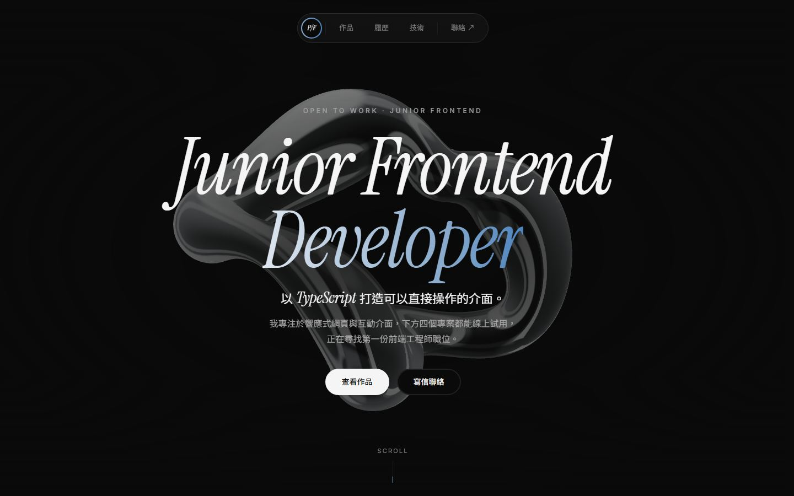
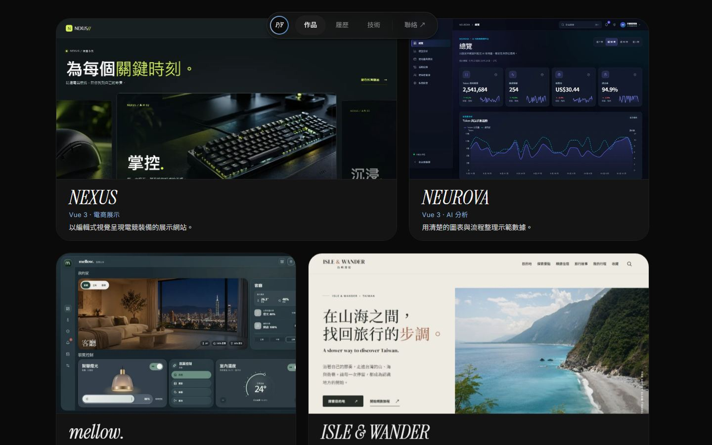

# Frontend Developer Portfolio

以 **React + TypeScript** 製作的個人作品集網站，展示四個可線上操作的 **Vue 3 前端專案**，以及響應式介面、動畫互動、資料視覺化與使用者體驗的實作成果。

**目前定位：Junior Frontend Developer／應徵前端工程師**

[**正式網站・Live Website**](https://personal-project-home.vercel.app/) · [**精選作品・Selected Works**](https://personal-project-home.vercel.app/#work) · [**原始碼・GitHub**](https://github.com/qwer070591-arch/personal-project-home)

> **版本狀態：V3 已正式部署。** 正式站由 `main` 分支部署；[V3 預覽分支](https://github.com/qwer070591-arch/personal-project-home/tree/preview/v3-portfolio-20261119) 保留供比較。原參考影片未取得使用授權，因此正式版預設顯示 WebGL／CSS 雕塑，不載入該影片。

## 網站預覽





[手機版 Hero](docs/screenshots/hero-mobile.jpg) · [手機版作品展示](docs/screenshots/selected-work-mobile.jpg) · [桌機作品詳情](docs/screenshots/project-dialog-desktop.jpg) · [手機作品詳情](docs/screenshots/project-dialog-mobile.jpg) · [Journal](docs/screenshots/journal-desktop.jpg) · [Explorations](docs/screenshots/explorations-desktop.jpg) · [Contact](docs/screenshots/contact-desktop.jpg)

## 精選專案

四個作品都提供線上展示與獨立 GitHub 儲存庫。這些專案本身以 Vue 3 為主，**本作品集網站則採用 React 19**。

| 專案 | 作品重點 | 主要技術 | 連結 |
| --- | --- | --- | --- |
| **NEXUS** — 電競商品展示 | 商品探索、輪播、瀏覽器儲存的購物車與收藏；不提供真實結帳 | Vue 3、Vite、GSAP、Embla Carousel | [Demo](https://nexus-gaming-ecommerce.vercel.app/) · [Code](https://github.com/qwer070591-arch/nexus-gaming-ecommerce) |
| **NEUROVA** — AI 數據儀表板 | 模型分析、使用量與費用圖表、活動紀錄及模擬使用者管理 | Vue 3、TypeScript、Pinia、ECharts | [Demo](https://neurova-dashboard-six.vercel.app/) · [Code](https://github.com/qwer070591-arch/neurova-dashboard) |
| **mellow.** — 智慧居家介面 | 房間切換、燈光、窗簾、溫控和情境控制；不連接真實 IoT 設備 | Vue 3、TypeScript、Pinia、SCSS | [Demo](https://mellow-smart-home.vercel.app/) · [Code](https://github.com/qwer070591-arch/mellow-smart-home) |
| **ISLE & WANDER** — 台灣旅遊探索 | 景點與住宿瀏覽、收藏、多日行程規劃；不提供訂房與付款 | Vue 3、TypeScript、Vue Router、Pinia | [Demo](https://isle-wander-ui.vercel.app/) · [Code](https://github.com/qwer070591-arch/isle-wander-ui) |

作品文案、圖片與連結統一維護於 [`src/data/content.ts`](src/data/content.ts)，避免畫面與文件資訊分散。Journal 的內容基於專案實作紀錄，不是虛構文章；Stats 由作品資料計算，不使用虛構經歷或客戶數據。

## 網站亮點

- **Cinematic Hero**：深色視覺、GSAP 文字進場、技術詞輪播與 WebGL2 金屬雕塑；無 WebGL 時使用 CSS 備援。
- **Floating Navigation**：置中的膠囊式導覽，支援目前區塊高亮、鍵盤操作及頁內跳轉。
- **Selected Works**：桌機採 `7 / 5 / 5 / 7` 非對稱 Bento 排版；作品卡片可開啟詳情對話框，查看截圖、技術與 Demo / GitHub。
- **Project Insights / Journal**：四則來自實際開發過程的技術重點，以橫向卡片呈現。
- **Explorations**：GSAP ScrollTrigger 視差畫廊與圖片 Lightbox；平板、手機及 reduced-motion 使用較輕量的捲動展示。
- **About / Skills / Stats**：真實的學習背景、前端技術分類，以及從專案資料計算的統計。
- **Contact / Footer**：聯絡連結、漸層互動及跑馬燈；背景影片為可選功能。

### RWD、互動與無障礙

- 桌機、平板與手機分別調整排版；作品詳情支援 Enter、方向鍵、Escape、焦點返回及背景關閉。
- 對 `prefers-reduced-motion` 提供動畫替代：不強制顯示 Loading Screen、停用主要視差與跑馬燈，手機保留 CSS 雕塑。
- 手機首次進入直接顯示 Hero；一般模式約 1.5 秒後、且 Hero 可見時才初始化 WebGL，以降低首屏阻塞。
- 桌機／平板首次瀏覽保留可略過的 Loading Screen；非首屏資源按需載入。
- `index.html` 內保留 `<noscript>` 內容，讓停用 JavaScript 的訪客仍可取得作品介紹、主要連結與聯絡方式。

## 技術架構

| 類別 | 技術 |
| --- | --- |
| 核心架構 | React 19、TypeScript、Vite |
| UI 與排版 | Tailwind CSS 3、CSS Custom Properties |
| 動態效果 | GSAP、ScrollTrigger、Framer Motion（LazyMotion） |
| 媒體與視覺 | WebGL2、自訂 Chrome Sculpture、hls.js（可選 HLS 影片） |
| 字體 | Inter、Instrument Serif、Noto Sans TC |
| 測試與部署 | TypeScript Typecheck、Playwright（驗收使用）、Lighthouse（驗收使用）、GitHub、Vercel |

### 專案結構

```text
personal-project-home/
├── index.html                 # Vite 入口與 no-JS 備援
├── src/
│   ├── App.tsx                # 區塊組合、Loading、Lazy Loading
│   ├── components/            # Hero、Works、About、Journal、Explorations 等
│   ├── data/content.ts        # 作品、技能、履歷及統計資料
│   ├── hooks/                 # 導覽區塊與原生 Dialog 行為
│   └── lib/chrome.ts          # WebGL2 金屬雕塑
├── public/                    # Favicon 與作品圖片素材
├── docs/screenshots/          # 網站驗收截圖
├── dist/                      # Vite 產生的正式建置輸出
├── vercel.json                # Vercel 建置設定
├── README.md
└── DESIGN.md                  # 視覺設計與互動規則
```

## 本機啟動

建議使用符合 `package.json` 相依套件要求的 Node.js 版本（開發驗收使用 Node.js 24）。

```bash
git clone https://github.com/qwer070591-arch/personal-project-home.git
cd personal-project-home
npm ci
npm run dev
```

Vite 會輸出本機開發網址。驗證正式建置：

```bash
npm run typecheck
npm run build
npm run preview
```

`npm run build` 執行 TypeScript 編譯檢查與 Vite 建置，輸出到 `dist/`。`dist/` 是產物目錄；應以 `src/`、`public/`、根目錄 `index.html` 為主要修改來源，不要直接手動修改編譯結果。

## 可選 Hero 影片與授權

網站已實作 hls.js（Safari 支援原生 HLS 時使用原生播放）及 MP4／HLS 背景影片路徑，但**正式版預設未設定影片**。原參考 Mux 串流回傳 HTTP 403，且沒有確認發布授權，因此沒有將它內建到網站。

如有合法授權的影片，建立不提交到 Git 的 `.env.local`：

```dotenv
VITE_HERO_HLS_URL=https://example.com/your-licensed-video.m3u8
```

也可使用具備適當權利的 MP4 網址。媒體播放失敗或使用者偏好減少動畫時，系統使用雕塑視覺備援；Contact 的可選影片會延後至接近可視範圍才載入。**Vite 的 `VITE_*` 變數會進入瀏覽器端建置，請勿放入密碼、金鑰或私密連結。**

## 測試與品質

V3 發布前已由 Codex / Claude Code 工作流程進行本機檢查與獨立驗收：

- `npm run typecheck`、`npm run build`、`git diff --check` 通過。
- Playwright Chromium 檢查 **1440×900、1024×768、768×1024、390×844、360×800**。
- 驗證四個作品 Dialog、方向鍵切換、Escape、焦點返回、Lightbox、導航狀態、圖片及水平溢出。
- 測試 reduced-motion、無 WebGL 與模擬 HLS HTTP 403 的備援行為；預覽環境亦完成主要互動檢查。

Lighthouse 13.6.0／Chrome 157、本機 Production Build 模擬節流，三次測量的中位數（最後一次效能優化後）：

| 指標 | 桌機 | 手機 |
| --- | ---: | ---: |
| Performance | 100 | 93 |
| FCP | 205 ms | 755 ms |
| LCP | 205 ms | 755 ms |
| TBT | 2 ms | 306 ms |
| CLS | 0.03 | 0.00 |

**限制：** 手機效能優化的 Lighthouse 分數並未比前次基準提升（96 → 93）；兩次 LCP 對應不同內容，不能直接拿來判定 Hero 的顯示速度。以上是實驗室條件測試，不能代表所有實際裝置。實體手機、Safari、Firefox 與螢幕閱讀器尚未完整驗證；也不宣稱已取得 WCAG 符合性認證。

## 部署

- **Production**：[personal-project-home.vercel.app](https://personal-project-home.vercel.app/) — V3 已合併至 `main` 並完成 Vercel Production 部署。
- **Preview**：[V3 Preview](https://personal-project-home-git-preview-v3-por-5c2f92-qwer070591-arch.vercel.app/) — 預覽環境可能需要 Vercel 登入。
- **GitHub**：[來源儲存庫](https://github.com/qwer070591-arch/personal-project-home)。
- **Build Command**：`npm run build`；**Output Directory**：`dist`（參考 [`vercel.json`](vercel.json)）。

正式發佈與原始碼修改應透過 Git 版本控制；請先在 Preview 驗收較大的視覺或互動改動，再更新正式站。

---

本網站用於展示個人前端開發能力與真實專案，並持續改進功能、無障礙體驗與效能。
