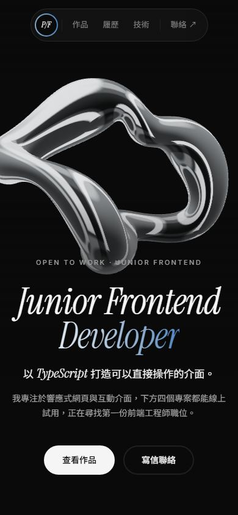
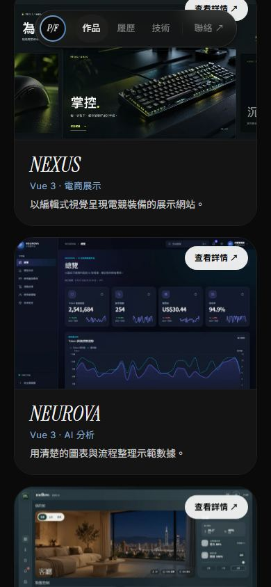
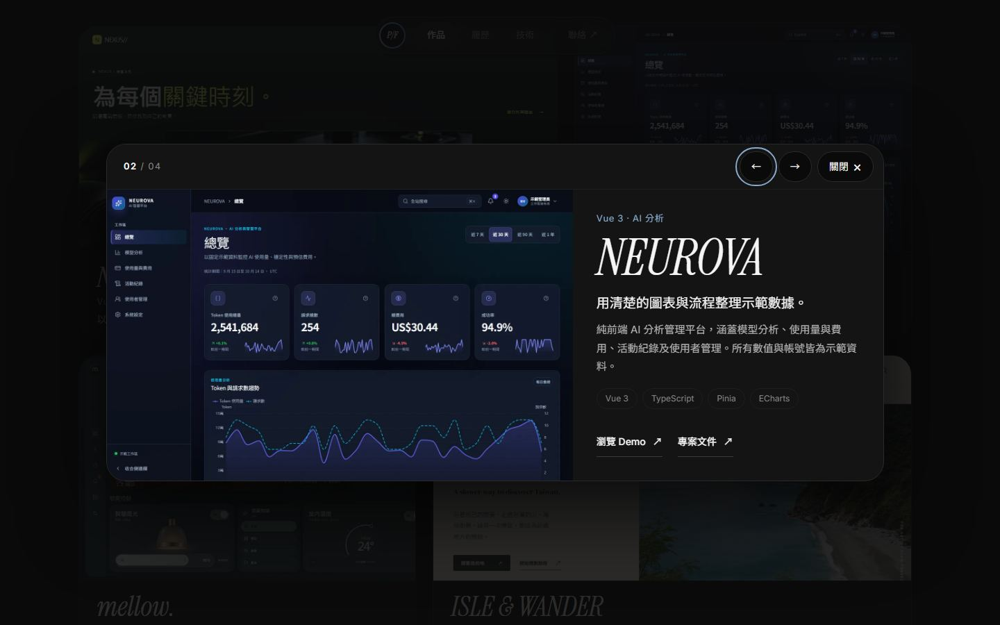
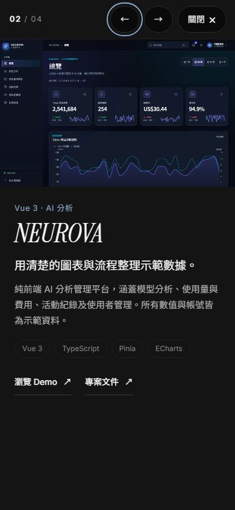
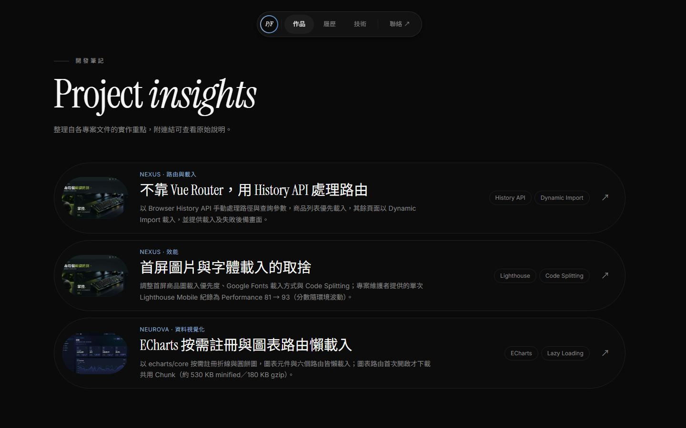
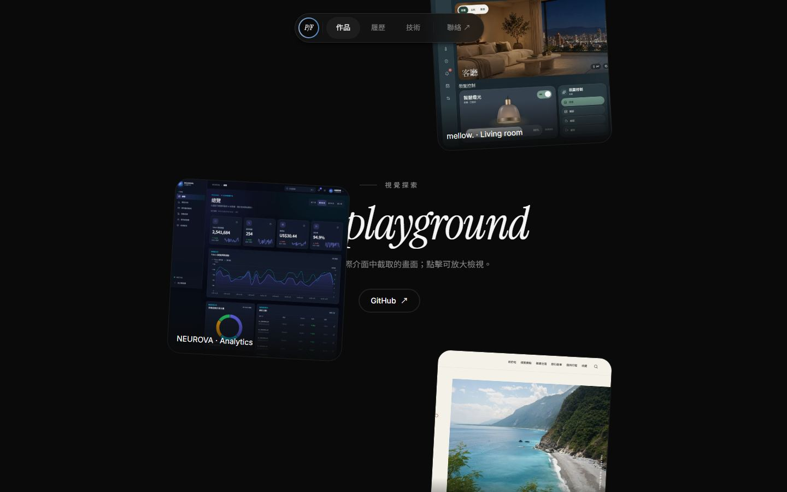
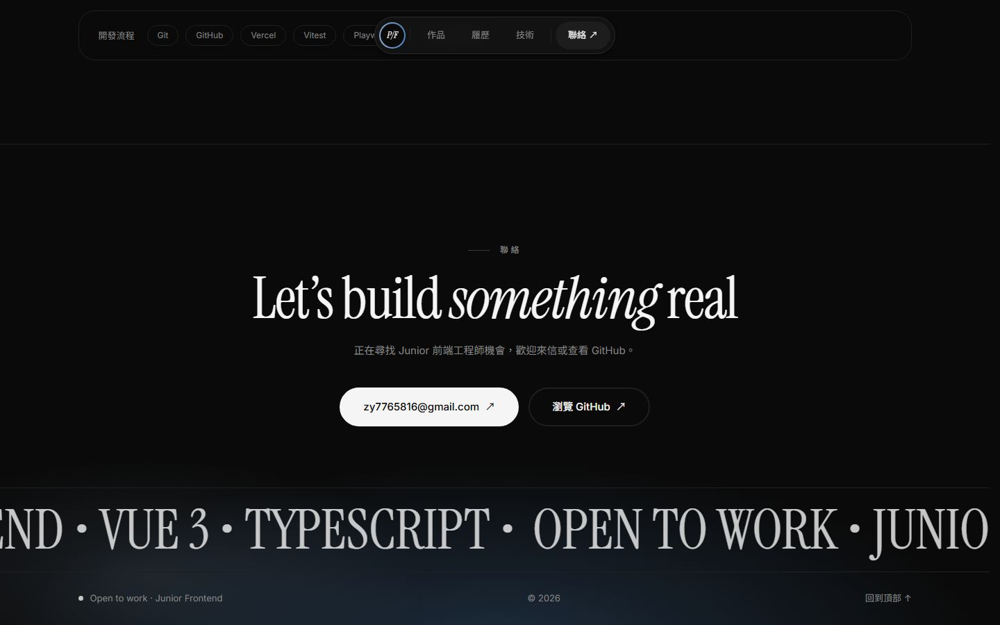

# Personal Portfolio

**Junior Frontend Developer portfolio (V3)** — a single-page React site presenting four real, live Vue 3 projects, a résumé, project insights, and contact details.

> **Status:** V3 is on the `preview/v3-portfolio-20261119` branch and has a Vercel Preview deployment. The production site remains on the previous version from `main`.

## Features

- **Loading screen:** On desktop and tablet, a first-visit 000 → 100 intro (2.7 s) with rotating words, progress bar, and a Skip button. Phones below 768 px and `prefers-reduced-motion` go straight to the Hero. The counter updates without a React render on every frame.
- **Cinematic Hero:** a full-screen video layer driven by **hls.js** (native HLS on Safari) with dark overlay, bottom fade, GSAP entrance, a rotating role word (Vue 3 / TypeScript / Pinia / GSAP — technologies used in the projects), a scroll indicator, and a static fallback. The fallback is the custom **WebGL2 chrome sculpture** (a CSS illustration if WebGL2 is unavailable). Phones show the CSS sculpture first and initialize WebGL after about 1.5 s only while the Hero is visible; reduced-motion phones keep the CSS version. Desktop starts WebGL immediately. **No video is bundled or enabled by default** — see "Hero video and licensing".
- **Selected Works:** asymmetric 7 / 5 / 5 / 7 Bento of the four real projects with a hover overlay, animated gradient border, image zoom, and a native modal `<dialog>` detail view that opens from the clicked card (screenshot, description, technologies, Demo/GitHub links, previous/next, Esc/backdrop/Close, focus return).
- **Résumé and Skills:** the supplied background text and facts; each technology mapped to the projects that use it.
- **Project insights (Journal):** four horizontal pills. Each statement restates that project's own README and links to the repository; there are no invented articles or dates.
- **Explorations:** GSAP ScrollTrigger pinned heading with two parallax columns of crops of the owner's own project screenshots, plus a lightbox. Below 1024 px (and under reduced motion) it becomes a lighter horizontal scroll-snap strip with no pin or parallax.
- **Stats:** counts derived from the real data (4 projects, 9 technologies, 3 TypeScript projects) plus the development workflow; no invented years, clients, or satisfaction scores.
- **Contact / footer:** a cinematic glow (or a flipped video when one is configured), a GSAP horizontal marquee, gradient-hover CTAs, the real email address and GitHub profile. An optional Contact video is requested only when it approaches the viewport.
- **Floating pill navigation** with one consistent active state for every item, including Contact.

## Tech Stack

React 19, Vite, TypeScript, Tailwind CSS 3, GSAP + ScrollTrigger, Framer Motion (`LazyMotion`), and hls.js (lazy-loaded only when a video URL is configured). Fonts: Inter, Instrument Serif, Noto Sans TC (Google Fonts, non-blocking). The technologies in the table below belong to the featured projects, not to this site.

## Project structure

```
index.html              entry (includes a <noscript> fallback with the four projects and links)
public/                 favicon and project screenshots (PNG/JPG originals + the WebP files the app uses)
src/
  App.tsx               page composition, first-visit loading logic, lazy chunks
  data/content.ts       single source of truth for all real content
  components/           Hero, SelectedWorks, ProjectDialog, About, Journal, Explorations, Lightbox, Stats, Contact, ...
  hooks/                useActiveSection, useNativeDialog
  lib/chrome.ts         WebGL2 chrome sculpture (ported from the original static build)
dist/                   production build output (see "Build output")
```

## Featured Projects

| Project | Description | Project technologies | Live Demo | Repository |
| --- | --- | --- | --- | --- |
| **NEXUS** | Gaming equipment showcase with product discovery, an interactive carousel, and browser-saved cart and favorites. Demo only; no real checkout. | Vue 3, Vite, JavaScript, CSS, GSAP, Embla Carousel | [Open demo](https://nexus-gaming-ecommerce.vercel.app/) | [GitHub](https://github.com/qwer070591-arch/nexus-gaming-ecommerce) |
| **NEUROVA** | Frontend AI analytics dashboard with charts, activity logs, and simulated user management. All account and usage data is demonstrative. | Vue 3, TypeScript, Vite, Vue Router, Pinia, ECharts, Tailwind CSS | [Open demo](https://neurova-dashboard-six.vercel.app/) | [GitHub](https://github.com/qwer070591-arch/neurova-dashboard) |
| **mellow.** | Smart-home interface for rooms, lighting, curtains, temperature, and scenes. Browser-saved settings do not control real IoT devices. | Vue 3, TypeScript, Vite, Vue Router, Pinia, SCSS | [Open demo](https://mellow-smart-home.vercel.app/) | [GitHub](https://github.com/qwer070591-arch/mellow-smart-home) |
| **ISLE & WANDER** | Taiwan travel discovery with destinations, stays, favorites, and a multi-day itinerary planner. No booking or payment. | Vue 3, TypeScript, Vite, Vue Router, Pinia | [Open demo](https://isle-wander-ui.vercel.app/) | [GitHub](https://github.com/qwer070591-arch/isle-wander-ui) |

Descriptions and technology lists were checked against the project READMEs. The Demo links were opened during the earlier pre-release review and were not re-verified in V3.

## Getting Started

Requires Node.js 20.19+ (tested with Node 24).

```powershell
npm install
npm run dev          # Vite dev server
npm run typecheck    # tsc -b --noEmit
npm run build        # type-check + production build into dist/
npm run preview      # serve the built dist/
```

## Hero video and licensing

The original reference used a third-party Mux HLS stream. It could not be used: the URL returned **HTTP 403** when checked, and the permission to publish it is unknown. The Hero and Contact video layers are therefore **off by default**. To enable them, set an HLS (`.m3u8`) or MP4 URL **that you have the right to publish**:

```powershell
# .env.local (not committed)
VITE_HERO_HLS_URL=https://example.com/your-licensed-video.m3u8
```

The video is muted and looping, paused when off-screen, never started under reduced motion, and any error falls back to the sculpture. During development the success path was verified with Mux's public test stream (test only, not shipped).

## Build output

The Vite build writes to `dist/`. The previous hand-written static site was archived locally in `.backups/` before the switch. The repository still tracks `dist/`. On the Preview branch, `vercel.json` runs `npm run build` and serves `dist/`; this branch-specific configuration does not change the production project's global settings.

## Responsive design, accessibility, and testing

After the performance pass, Playwright Chromium checked the production build at 1440 × 900, 1024 × 768, 768 × 1024, 390 × 844, and 360 × 800: four project dialogs and their links, arrow navigation, Escape, lightbox, Contact navigation state, refresh state, images, console errors, and horizontal overflow. A touch tap on the mobile project card and focus return after Escape passed. Reduced motion skips the intro; a forced WebGL-unavailable test showed the CSS fallback. A separate temporary build with a simulated HTTP 403 HLS source kept the Hero sculpture visible and delayed the Contact video request until it approached the viewport. These automated checks do not replace physical-device or screen-reader testing.

Lighthouse 13.6.0 with headless Chrome 157, simulated throttling, and the same local production-preview setup was run three times per form factor before and after the pass. The table shows medians:

| Form factor | Performance | FCP | LCP | TBT | CLS |
| --- | --- | --- | --- | --- | --- |
| Desktop before → after | 100 → 100 | 207 → 205 ms | 207 → 205 ms | 4 → 2 ms | 0.05 → 0.03 |
| Mobile before → after | 96 → 93 | 757 → 755 ms | 757 → 755 ms | 220 → 306 ms | 0.01 → 0.00 |

The baseline mobile final screenshot still showed the loading screen; the final mobile screenshot showed the usable Hero. The two LCP values therefore represent different content and must not be treated as a direct Hero-speed comparison. The mobile Lighthouse score did **not** improve in this independent run. Accessibility was 100, Best Practices 100, and SEO 92 in these runs. Lab results vary with browser and GPU conditions; physical devices, Safari, Firefox, and screen readers were not tested. This is not a WCAG conformance claim.

## Screenshots

Captured from the local V3 build with Playwright and compressed for repository use.

**Hero**




**Selected Works**




**Project detail dialog**





**Project insights, Explorations, Contact**







## Deployment

V3 Preview: [preview branch deployment](https://personal-project-home-git-preview-v3-por-5c2f92-qwer070591-arch.vercel.app/) (Vercel sign-in may be required). The [production site](https://personal-project-home.vercel.app/) still serves the previous static version from `main`. The Preview branch's `vercel.json` specifies `npm run build` and the `dist` output directory; no production deployment has been made for V3.
